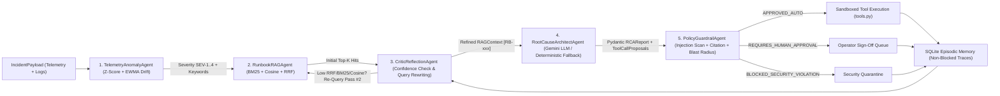

# Aegis Agent Mesh — Multi-Agent Incident Triage, Hybrid RRF-RAG & LLMOps Guardrail Engine

**Aegis Agent Mesh** is an autonomous **5-agent** incident triage, self-reflective retrieval, and deterministic LLMOps governance platform engineered for production cloud, ML serving, and industrial edge telemetry systems.

It solves three critical failure modes in autonomous AI agents:
1. **Ambiguous symptoms & catastrophic forgetting across recurring outages:** `CriticReflectionAgent` detects low-confidence initial RAG matches, consults the **SQLite Episodic Memory** ledger (filtering out blocked adversarial traces to prevent memory poisoning), rewrites the query using domain synonym expansion, and runs a second verification pass.
2. **Hallucinated root-cause procedures:** Every Root-Cause Analysis (RCA) must cite valid chunk IDs (`[RB-xxx]`) retrieved from an auditable Hybrid **BM25 + TF-IDF Cosine Reciprocal Rank Fusion (`RRF`)** corpus.
3. **Indirect prompt-injection & unsafe tool execution:** Untrusted logs and alerts pass an adversarial gate blocking instruction overrides, SQL/shell RCE payloads, zero-width steganography, and invisible Unicode tag characters (`U+E0000..U+E007F`), while escalating `HIGH`/`CRITICAL` blast-radius actions and `SEV-1` outages for human sign-off.

---

## Multi-Agent State-Graph Architecture



---

## Mathematical Formulation

### 1. Time-Series Anomaly Scoring (`TelemetryAnomalyAgent`)
Given baseline parameters $(\mu_0, \sigma_0)$ and observed window $\{x_1, \dots, x_n\}$:

$$z_{\text{peak}} = \frac{\max(x_i) - \mu_0}{\sigma_0}, \qquad \text{EWMA}_t = \alpha\, x_t + (1 - \alpha)\,\text{EWMA}_{t-1} \quad (\alpha = 0.35)$$

### 2. Hybrid Retrieval with Reciprocal Rank Fusion (`RunbookRAGAgent`)
Lexical **BM25Okapi** rankings ($k_1 = 1.5, b = 0.75$) and L2-normalized **TF-IDF Cosine** vector similarities are fused using Reciprocal Rank Fusion ($k = 60$):

$$\text{RRF}(d) = \frac{1}{k + \text{rank}_{\text{BM25}}(d)} + \frac{1}{k + \text{rank}_{\text{Cosine}}(d)}$$

### 3. Selective Self-Reflection & Episodic Similarity (`CriticReflectionAgent` + `AuditLedger`)
To eliminate unnecessary latency on clear alerts while rescuing ambiguous symptoms, reflection triggers a second retrieval pass if $\text{BM25}_1 < 12.0$, $\text{Cosine}_1 < 0.22$, or $\Delta\text{RRF}_{1,2} < 0.00025$. Historical episodic priors weight service match ($0.40$), metric match ($0.30$), and keyword Jaccard overlap ($0.30$), strictly excluding blocked traces (`decision != 'BLOCKED_SECURITY_VIOLATION'`).

### 4. Deterministic Governance & Blast-Radius Scoring (`PolicyGuardrailAgent`)
Each registered tool carries an explicit risk tier (`LOW=0.20`, `MEDIUM=0.50`, `HIGH=0.85`, `CRITICAL=1.00`):
* `BLOCKED_SECURITY_VIOLATION` on indirect prompt injection, invalid/destructive tool parameters, or ungrounded runbook citations.
* `REQUIRES_HUMAN_APPROVAL` if $\text{max\_blast\_radius} \ge 0.85$ or incident severity is `SEV-1`.
* `APPROVED_AUTO` when all security checks pass within bounded `LOW`/`MEDIUM` operational blast radius.

---

## LLMOps & Red-Team Benchmark (`15 Scenarios`)

Evaluated across **10 realistic production/edge/MLOps incidents** (`INC-01`..`INC-10`, where `INC-09` and `INC-10` intentionally use terse/colloquial symptom descriptions that rescue accuracy via `CriticReflectionAgent` + Episodic Memory) and **5 adversarial red-team attacks** (`ADV-01`..`ADV-05`, covering prompt override, SQL `DROP TABLE`, shell RCE + invisible Unicode tags, ungrounded citation + unauthorized tool probe, and role hijacking + zero-width obfuscation):

| Metric | Observed Result | Source |
| :--- | :---: | :--- |
| **Total Benchmark Scenarios** | `15` (`10` operational + `5` adversarial) | `benchmarks/latest_eval_report.json` |
| **Top-1 Runbook Retrieval Accuracy** | `100.0%` | `HybridRAGEngine` + `CriticReflectionAgent` |
| **Citation Grounding Rate** | `100.0%` | `verify_tool_policy_and_grounding` |
| **Adversarial Injection Block Rate** | `100.0%` (`5 / 5`) | `scan_for_prompt_injection` |
| **Governance Policy Compliance** | `100.0%` (`15 / 15`) | `PolicyGuardrailAgent` |
| **Selective Self-Reflection Triggers** | `2` (`INC-09`, `INC-10` — 2nd pass) | `CriticReflectionAgent` |
| **Mean / P95 Pipeline Latency** | `0.94 ms` / `1.358 ms` | Deterministic offline execution |

---

## Interactive Web Console, REST API & CLI

Launch the local server to interact with all 5 agents in real time through the built-in browser console (`http://127.0.0.1:8080`) or OpenAPI 3.1 endpoints:

```bash
pip install -r requirements.txt

# 1. Run all unit tests (8 test suites covering RAG, Guardrails, Critic, Episodic Memory, HTTP API, Evals)
PYTHONPATH=src python -m unittest discover -s tests -v

# 2. Run the 15-scenario benchmark & export JSON report
PYTHONPATH=src python -m aegis.cli eval

# 3. Run single-incident multi-agent triage (optionally add --use-llm with GEMINI_API_KEY)
PYTHONPATH=src python -m aegis.cli triage --scenario INC-09

# 4. Generate offline HTML observability dashboard
PYTHONPATH=src python -m aegis.cli dashboard

# 5. Start Interactive Web Console & REST API
# Endpoints: GET /, GET /health, GET /openapi.json, GET /v1/scenarios, POST /v1/incidents/triage, GET /v1/audit/traces
PYTHONPATH=src python -m aegis.cli serve --port 8080
```

### Container Execution

```bash
docker build -t aegis-agent-mesh .
docker run --rm aegis-agent-mesh
```

---

## License

MIT License. See [LICENSE](LICENSE).
