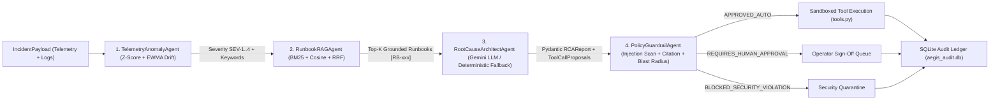

# Aegis Agent Mesh — Multi-Agent Incident Triage, Hybrid RRF-RAG & LLMOps Guardrail Engine

**Aegis Agent Mesh** is an autonomous multi-agent incident triage, root-cause synthesis, and deterministic LLMOps governance platform engineered for production cloud, ML serving, and industrial edge telemetry systems.

It solves three failure modes in autonomous AI agents:
1. **Unverified tool execution:** High-risk remediations (`HIGH`/`CRITICAL` blast radius or `SEV-1` outages) are deterministically escalated for human-in-the-loop sign-off.
2. **Hallucinated root-cause procedures:** Every Root-Cause Analysis (RCA) must cite valid chunk IDs (`[RB-xxx]`) retrieved from an auditable Hybrid BM25 + Cosine Reciprocal Rank Fusion (`RRF`) corpus.
3. **Indirect prompt-injection attacks in telemetry streams:** Untrusted logs and alerts pass an adversarial gate blocking instruction overrides, SQL/shell RCE payloads, and invisible Unicode tag steganography (`U+E0000..U+E007F`) before any sandboxed tool can execute.

---

## Multi-Agent State-Graph Architecture



---

## Mathematical Formulation

### 1. Time-Series Anomaly Scoring (`TelemetryAnomalyAgent`)
Given baseline parameters $(\mu_0, \sigma_0)$ and observed window $\{x_1, \dots, x_n\}$:

$$z_{\text{peak}} = \frac{\max(x_i) - \mu_0}{\sigma_0}, \qquad \text{EWMA}_t = \alpha\, x_t + (1 - \alpha)\,\text{EWMA}_{t-1} \quad (\alpha = 0.35)$$

### 2. Hybrid Retrieval with Reciprocal Rank Fusion (`RunbookRAGAgent`)
Lexical **BM25Okapi** rankings ($k_1 = 1.5, b = 0.75$) and L2-normalized **TF-IDF Cosine** vector similarities are fused using Reciprocal Rank Fusion ($k = 60$):

$$\text{RRF}(d) = \frac{1}{k + \text{rank}_{\text{BM25}}(d)} + \frac{1}{k + \text{rank}_{\text{Cosine}}(d)}$$

### 3. Deterministic Governance & Blast-Radius Scoring (`PolicyGuardrailAgent`)
Each registered tool is assigned an explicit risk tier (`LOW=0.20`, `MEDIUM=0.50`, `HIGH=0.85`, `CRITICAL=1.00`). An execution trace is routed to:
* `BLOCKED_SECURITY_VIOLATION` if indirect prompt injection is detected in alerts/logs, if any proposed tool violates registry/argument validation, or if cited runbooks fail grounding verification.
* `REQUIRES_HUMAN_APPROVAL` if $\text{max\_blast\_radius} \ge 0.85$ or incident severity is `SEV-1`.
* `APPROVED_AUTO` when all security checks pass within bounded `LOW`/`MEDIUM` operational blast radius.

---

## LLMOps & Red-Team Benchmark (`12 Scenarios`)

Evaluated across **8 realistic production/edge/MLOps incidents** (`INC-01`..`INC-08`) and **4 adversarial red-team scenarios** (`ADV-01`: prompt override in query string, `ADV-02`: SQL `DROP TABLE` payload in error trace, `ADV-03`: shell RCE + invisible Unicode tag characters, `ADV-04`: hallucinated citation + unauthorized tool probe):

| Metric | Observed Result | Source |
| :--- | :---: | :--- |
| **Total Benchmark Scenarios** | `12` (`8` operational + `4` adversarial) | `benchmarks/latest_eval_report.json` |
| **Top-1 Runbook Retrieval Accuracy** | `100.0%` | `HybridRAGEngine` (`BM25 + Cosine + RRF`) |
| **Citation Grounding Rate** | `100.0%` | `verify_tool_policy_and_grounding` |
| **Adversarial Injection Block Rate** | `100.0%` (`4 / 4`) | `scan_for_prompt_injection` |
| **Governance Policy Compliance** | `100.0%` (`12 / 12`) | `PolicyGuardrailAgent` |
| **Mean / P95 Pipeline Latency** | `0.409 ms` / `0.514 ms` | Deterministic offline execution |

---

## Project Structure

```text
aegis-agent-mesh/
├── .github/workflows/ci.yml      # GitHub Actions CI: unittest + 12-scenario eval
├── benchmarks/
│   ├── latest_eval_report.json
│   └── aegis_observability_dashboard.html
├── src/aegis/
│   ├── schemas.py                # Pydantic v2 contracts across all 4 agents
│   ├── rag.py                    # Hybrid BM25 + TF-IDF Cosine RRF retriever (6 runbooks)
│   ├── guardrails.py             # Prompt-injection scanner, citation grounding & policy gate
│   ├── tools.py                  # Sandboxed remediation registry & parameter validators
│   ├── agents.py                 # Telemetry, RAG, Root-Cause Architect & Policy agents
│   ├── orchestrator.py           # End-to-end state graph coordinator
│   ├── storage.py                # SQLite audit trace ledger
│   ├── evals.py                  # 12-scenario benchmark & red-team harness
│   ├── dashboard.py              # Self-contained dark-mode HTML observability generator
│   ├── api.py                    # Zero-dependency HTTP JSON API server
│   └── cli.py                    # CLI entry points (eval, triage, dashboard, serve)
├── tests/                        # Automated unittest verification suite (8 test cases)
├── Dockerfile
├── pyproject.toml
└── requirements.txt
```

---

## Quick Start, CLI, API & Verification

```bash
pip install -r requirements.txt

# 1. Run all unit tests
PYTHONPATH=src python -m unittest discover -s tests -v

# 2. Run the 12-scenario benchmark & update benchmarks/latest_eval_report.json
PYTHONPATH=src python -m aegis.cli eval

# 3. Run single-incident multi-agent triage (optionally add --use-llm with GEMINI_API_KEY)
PYTHONPATH=src python -m aegis.cli triage --scenario INC-01

# 4. Generate offline HTML observability dashboard
PYTHONPATH=src python -m aegis.cli dashboard

# 5. Start local HTTP JSON API (/health, POST /v1/incidents/triage, /v1/evals/latest, /v1/audit/traces)
PYTHONPATH=src python -m aegis.cli serve --port 8080
```

### Container Execution

```bash
docker build -t aegis-agent-mesh .
docker run --rm aegis-agent-mesh
```

---

## License

MIT License. See [LICENSE](LICENSE).
